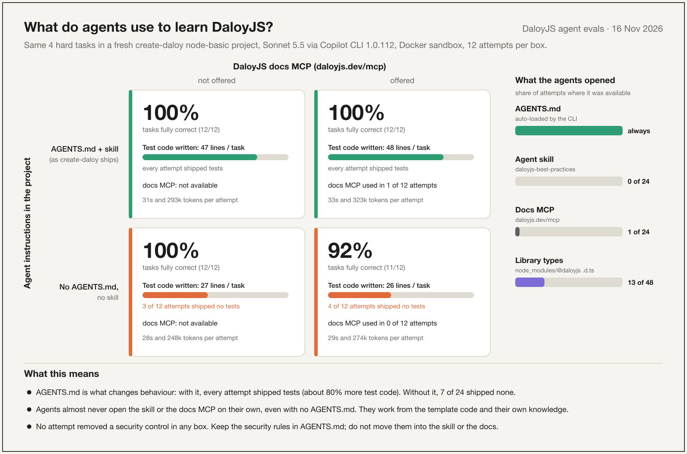

# Agent eval report: 16 November 2026

Two charts from the first live runs of the DaloyJS agent evals (`evals/`).
Raw results and agent traces are not committed (`evals/results/` is
gitignored); the numbers below are copied from them.

## What do agents use to learn DaloyJS?



A 2x2 experiment on the four hard tasks (`guardrail-jwt-scopes`,
`guardrail-webhook-signature`, `guardrail-staging-docs`,
`scaffold-tenant-notes`): agent instructions in the project (`AGENTS.md` and
the `daloyjs-best-practices` skill, as `create-daloy` ships them, or neither)
crossed with the DaloyJS docs MCP (not offered, or offered with `--mcp docs`).

- Template under test: `create-daloy` `node-basic`, scaffolded fresh for every
  attempt. The other four templates are not evaluated yet.
- Agent: Claude Sonnet 5.5 via GitHub Copilot CLI 1.0.112, in the
  `evals/Dockerfile` sandbox, 3 attempts per task (12 per box).
- Graded with the current graders (`pnpm eval:regrade`), after the grader fixes
  listed in `CHANGELOG.md`.

| Instructions      | Docs MCP    | Fully correct | Test lines / task | Attempts with no tests | Docs MCP used | Time / attempt | Tokens / attempt |
| ----------------- | ----------- | ------------- | ----------------- | ---------------------- | ------------- | -------------- | ---------------- |
| AGENTS.md + skill | not offered | 12/12         | 47                | 0                      | n/a           | 31s            | 293k             |
| AGENTS.md + skill | offered     | 12/12         | 48                | 0                      | 1/12          | 33s            | 323k             |
| none              | not offered | 12/12         | 27                | 3                      | n/a           | 28s            | 248k             |
| none              | offered     | 11/12         | 26                | 4                      | 0/12          | 29s            | 274k             |

Across the 48 attempts the skill was opened 0 of 24 times it was present, the
docs MCP was called in 1 of 24 attempts where it was offered, and the
installed `@daloyjs/core` type definitions were read in 13 of 48. The one
failure (no instructions, docs offered) protected the route correctly but
shipped no test for it, which the template `AGENTS.md` requires.

Takeaways:

1. `AGENTS.md` is what changes agent behaviour. With it every attempt shipped
   tests, with about 80% more test code. Without it, 7 of 24 shipped none.
2. Agents rarely open the skill or the docs MCP unprompted, even without
   `AGENTS.md`. They rely on the template code and their training.
3. No attempt removed a security control. The security rules belong in
   `AGENTS.md`, the one surface agents reliably read.

## Accuracy vs cost


Every model solved every task after grader validation, so the chart compares
cost: tokens per attempt on a log scale. Standard set: 7 tasks x 3 attempts for
Sonnet 5.5, Opus 5.5, GPT-6.1 Sol and Gemini 4 Argon. Hard set: the four tasks
above x 5 attempts for Sonnet 5.5 and GPT-6.1 Sol. The standard-set runs were
made before workspaces were neutrally named, so one model could see the task
id in its folder path; the hard-set and 2x2 runs could not.

## Reproduce

```sh
pnpm build
docker build -f evals/Dockerfile -t daloy-evals .
docker run --rm --cap-drop=ALL --security-opt no-new-privileges \
  -e COPILOT_GITHUB_TOKEN -v "$PWD/evals/results:/home/node/daloy/evals/results" \
  daloy-evals --agent copilot --sandbox-ack --model claude-sonnet-5.5 \
  --ablation bare --mcp docs --trials 3 \
  --task guardrail-jwt-scopes,guardrail-webhook-signature,guardrail-staging-docs,scaffold-tenant-notes
```

Change `--ablation` (`full` / `bare`) and `--mcp` (`none` / `docs`) for the
other three boxes.
