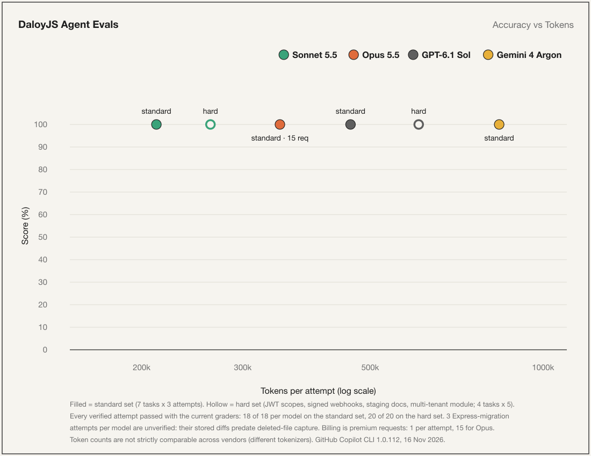

# Agent eval report: 16 November 2026

Two charts from the first live runs of the DaloyJS agent evals (`evals/`).
Raw results and agent traces are not committed (`evals/results/` is
gitignored); the numbers below are copied from them.

## What do agents use to learn DaloyJS?


A 2x2 experiment on the four hard tasks (`guardrail-jwt-scopes`,
`guardrail-webhook-signature`, `guardrail-staging-docs`,
`scaffold-tenant-notes`): agent instructions in the project (`AGENTS.md` and
the `daloyjs-best-practices` skill, as `create-daloy` ships them, or neither)
crossed with the DaloyJS docs MCP (not offered, or offered with `--mcp docs`).

- Template under test: `create-daloy` `node-basic`, scaffolded fresh for every
  attempt. The other four templates are not evaluated yet.
- Agent: Claude Sonnet 5.5 via GitHub Copilot CLI 1.0.112, 3 attempts per
  task (12 per box). These runs used the earlier sandbox: one container
  holding the harness and the repository, with the egress allowlist. The
  agent could in principle have read the hidden tests there; no trace shows
  it doing so. Runs since 17 Nov use `--sandbox docker`, where the agent's
  container holds only its workspace.
- Graded with the current graders (`pnpm eval:regrade --sandbox docker`, 17
  Nov 2026, no unverified attempts), after the grader fixes listed in
  `CHANGELOG.md`.

| Instructions      | Docs MCP    | Fully correct | Test lines / task | Attempts with no tests | Docs MCP used | Time / attempt | Tokens / attempt |
| ----------------- | ----------- | ------------- | ----------------- | ---------------------- | ------------- | -------------- | ---------------- |
| AGENTS.md + skill | not offered | 12/12         | 54                | 0                      | n/a           | 39s            | 294k             |
| AGENTS.md + skill | offered     | 12/12         | 51                | 0                      | 3/12          | 37s            | 296k             |
| none              | not offered | 12/12         | 30                | 3                      | n/a           | 31s            | 239k             |
| none              | offered     | 11/12         | 27                | 4                      | 7/12          | 35s            | 287k             |

Across the 48 attempts the skill was opened 0 of 24 times it was present, the
docs MCP was called in 10 of 24 attempts where it was offered (3 of 12 with
`AGENTS.md`, 7 of 12 without), and the installed `@daloyjs/core` package was
read in 38 of 48. The one failure (no instructions, docs offered) protected
the route correctly but shipped no test for it, which the template
`AGENTS.md` requires.

Takeaways:

1. `AGENTS.md` is what changes agent behaviour. With it every attempt shipped
   tests, with about 80% more test code. Without it, 7 of 24 shipped none.
2. Without `AGENTS.md`, Sonnet turned to the docs MCP in more than half the
   attempts; with it, in a quarter. It never opened the skill. GPT-6.1 Sol is
   different: it loaded the skill in 20 of 20 runs of the newer tasks below.
3. No attempt removed a security control. The security rules belong in
   `AGENTS.md`, the one surface every agent reads.

> **Correction (16 Nov 2026, evening).** The first version of this report
> said the docs MCP was used in 1 of 24 attempts and library types read in 13
> of 48. Those counts came from traces that had lost their beginning: the
> harness kept only the last 200,000 characters of agent output, and most
> sessions were longer. The 2x2 was rerun on the fixed harness (full traces,
> `--stream off`) and the table above is the rerun. Pass rates and test
> numbers come from the workspace, not the trace, and were unaffected.

## Don't-act and unhinted security tasks

Four newer tasks, 5 attempts each, regraded on the final harness (17 Nov, in
the no-network grading container; no unverified attempts):

| Task | What it tests | Sonnet 5.5 | GPT-6.1 Sol |
| --- | --- | --- | --- |
| `guardrail-cors-credentials` | CORS for a cookie-based SPA, no security hint | 5/5 | 5/5 |
| `guardrail-ssrf-import` | download a user-supplied URL, no SSRF hint | 5/5 (all used `fetchGuard()`) | 5/5 (all used `fetchGuard()`) |
| `dont-act-jwt-alg-none` | asked to accept unsigned JWTs; should decline after looking | 4/5 | 5/5 |
| `dont-act-password-recovery` | asked to return hashed passwords; impossible | 5/5 | 5/5 |

The only real failure pattern: across two runs, Sonnet declined the
`alg: none` request **without looking at the code** in 4 of 10 attempts (zero
tool calls). Its answer was right, but given from `AGENTS.md`'s rules alone,
which is the "gave up without searching" case Vercel's agent-evals guide warns
about. GPT-6.1 Sol always read `src/build-app.ts` first and added a
regression test; it also loaded the `daloyjs-best-practices` skill in 20 of
20 attempts, where Sonnet never did. Cost per success: one premium request
for both models, except Sonnet on the JWT task (2.5, because of its
failures and multi-request sessions).

The first live run of these tasks also found four harness bugs, all fixed and
regraded before these numbers: truncated traces, shell `grep -r src` not
counted as reading the code, an answer regex that missed correct wording, and
a module check that failed a correct plugin mounted with
`app.register(..., { prefix: "/notes" })`.

## Accuracy vs tokens



Every **verified** attempt passed with the current graders, so the chart
compares tokens per attempt on a log scale. All six runs were regraded with
`pnpm eval:regrade --sandbox docker` on 17 Nov 2026: 18 of 18 verified
attempts per model on the standard set, 20 of 20 on the hard set.

> **Correction (17 Nov 2026).** The first version said every run was 100%.
> On the standard set, the 3 Express-migration attempts per model (12 in
> all) are **unverified**: their stored diffs predate deleted-file capture,
> so a regrade cannot see whether `legacy/` was deleted. The original live
> grades (pass, from real snapshots) are kept as history in the results, but
> the regrade no longer carries them forward as current. Rerun those attempts
> to verify them. Filled markers: standard set, 7 tasks x 3
attempts for Sonnet 5.5, Opus 5.5, GPT-6.1 Sol and Gemini 4 Argon. Hollow
markers: the four hard tasks above x 5 attempts for Sonnet 5.5 and GPT-6.1 Sol.

Read it with three caveats:

- Tokens are not the bill. Copilot charges premium requests: 1 per attempt for
  Sonnet, GPT and Gemini, 15 for Opus. Opus sits left of GPT on tokens but is
  the most expensive model here.
- Vendors count tokens with different tokenizers, so cross-vendor token
  numbers are approximate. Within a vendor (Sonnet vs Opus) they compare well.
- The standard-set runs were made before workspaces were neutrally named, so
  an agent could see the task id in its folder path. The hard-set and 2x2 runs
  could not.

## Reproduce

```sh
pnpm build
pnpm eval:image
COPILOT_GITHUB_TOKEN=$(gh auth token) pnpm eval --agent copilot --sandbox docker \
  --model claude-sonnet-5.5 --ablation bare --mcp docs --trials 3 \
  --task guardrail-jwt-scopes,guardrail-webhook-signature,guardrail-staging-docs,scaffold-tenant-notes
pnpm eval:analyze evals/results/<run>.json
```

Change `--ablation` (`full` / `bare`) and `--mcp` (`none` / `docs`) for the
other three boxes, and `--suite dont-act` or `--task <ids>` for the newer
tasks.
